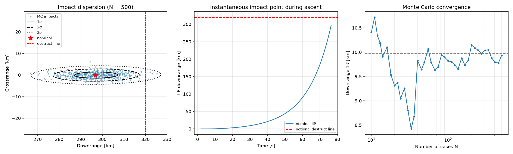

# traj3dof — Suborbital 3DOF Trajectory & Monte Carlo Dispersion Tool

A small Python tool that propagates a suborbital rocket trajectory, runs Monte Carlo
dispersions on the impact point, and traces the instantaneous impact point (IIP) during
ascent against a notional destruct line. It is a simplified version of a flight-analysis
workflow: nominal trajectory → dispersions → impact ellipse → safety limit check.



## Usage
```bash
python3 -m venv .venv && source .venv/bin/activate
pip install -r requirements.txt
python3 traj3dof.py                 # nominal trajectory -> nominal.png
python3 montecarlo.py -n 1000       # dispersions + IIP -> montecarlo.png
```

## Model
State: inertial position, velocity, mass, s = [r, v, m] (7 states), Earth-centered frame.

$$\dot{\mathbf r}=\mathbf v,\qquad
\dot{\mathbf v}=-\frac{\mu}{r^3}\mathbf r+\frac{T}{m}\hat{\mathbf u}_T-\frac{\rho V_{rel}C_DS}{2m}\mathbf V_{rel},\qquad
\dot m=-\frac{T}{g_0I_{sp}}$$

- Round, non-rotating Earth; inverse-square gravity
- Exponential atmosphere, $\rho=\rho_0e^{-h/H}$, $H = 8.5$ km; constant $C_D$
- Single stage, constant thrust and $I_{sp}$
- Guidance: vertical rise → pitch kick → gravity turn (nominal). The nominal pitch angle vs.
  time is stored and flown **open-loop** in dispersed cases, and thrust is held in the launch
  plane (guided vehicle, no weathercocking)
- Wind: constant horizontal wind below 15 km, acting through drag
- Integrated with `scipy.integrate.solve_ivp` (RK45, rtol 1e-9), with phase-by-phase
  integration and a terminal event at impact

**IIP:** computed from the current state as a vacuum Keplerian conic. The tool solves for
the descending intersection with $r=R_\oplus$ using
$r=\dfrac{p}{1+e\cos\nu}$, then converts it to downrange and crossrange.

## Nominal results
| Burnout | Apogee | Impact |
|---|---|---|
| t = 76.5 s, 61.9 km alt, 2,422 m/s | 365 km at t = 338 s | 296.8 km downrange at t = 635 s |

Ideal ΔV is 3,535 m/s, so gravity + drag + steering losses come to about 1,110 m/s.

## Monte Carlo (N = 1000)
1σ dispersions (assumed): thrust 1%, Isp 0.5%, dry mass 2%, C_D 5%, pointing 0.1°,
wind 7 m/s per axis.

| Output | Result |
|---|---|
| Impact 1σ | 9.6 km downrange × 1.4 km crossrange |
| Apogee | 366 ± 12 km |
| Ellipse containment (1/2/3σ) | 37.9 / 87.4 / 98.4 % vs. 2D Gaussian theory 39.3 / 86.5 / 98.9 % |
| Cases beyond 320 km destruct line | 0.8 % ± 0.3 % |

Note that a 3σ ellipse in 2D contains about 98.9% of cases, not 99.7% as in 1D:
$P = 1 - e^{-k^2/2}$.

## Verification
- **IIP vs. propagated impact:** the IIP at burnout is 297.6 km and the propagated impact is
  296.8 km. The 0.3% difference is reentry drag, which the vacuum IIP ignores.
- **Pitch-table replay:** flying the stored pitch program reproduces the gravity-turn
  nominal impact point to within 20 m.
- **Statistics:** ellipse containment matches Gaussian theory, and the convergence plot shows
  the downrange σ settling as N increases (standard error ∝ 1/√N).

## Findings
- Downrange dispersion dominates crossrange by about 7×, because the propulsion and drag
  dispersions all act in-plane.
- Higher thrust *shortens* range. The pitch program is time-indexed, so a hotter motor burns
  out earlier while still pitched steeper.
- An unguided gravity turn amplifies early wind errors. Steering along the air-relative
  velocity (weathercocking), a 15 m/s crosswind moved impact ~136 km crossrange. Holding the
  launch plane and flying a stored pitch program brought this down to ~3 km. This is why
  real vehicles fly a guided pitch program instead of a pure gravity turn.

## Limitations / next steps
- Earth rotation (Coriolis/centrifugal terms), WGS-84 ellipsoid, J2
- US Standard Atmosphere 1976 / GRAM, and altitude-varying wind profiles
- Mach-dependent C_D, plus multiple stages with stage-impact dispersions
- Failure-mode trajectories and debris fragment classes with their own ballistic coefficients
- Expected-casualty ($E_c$) estimate using population density over the impact distribution
- Vectorized or parallel Monte Carlo
